# Manual de Integração CargoWise 2.0

### Guia Técnico, Funcional, Tributário e Homologação de Testes no ERP Volpe

Esta documentação detalha a arquitetura da API Ventana Node CargoWise 2.0. Aqui você encontrará o detalhamento das rotas, fluxos de validação, mapeamentos de tabelas, payloads esperados e listas de possíveis retornos, além de espaços dedicados para anexar evidências de homologação.

> [!NOTE]
> ### Central de Downloads Rápidos da Documentação
>
> [](https://raw.githubusercontent.com/MatheusRafaelPWI/Ventana_node_ApiCargoWise2.0/main/Manual_de_Integracao_CargoWise.pdf)
> &nbsp;
> [-059669?style=for-the-badge&logo=winrar&logoColor=white)](https://raw.githubusercontent.com/MatheusRafaelPWI/Ventana_node_ApiCargoWise2.0/main/arquivos.rar)
>
> * **PDF Executivo Oficial:** [`Manual_de_Integracao_CargoWise.pdf`](https://raw.githubusercontent.com/MatheusRafaelPWI/Ventana_node_ApiCargoWise2.0/main/Manual_de_Integracao_CargoWise.pdf) *(1.3 MB)*
> * **Pacote Completo (Pastas JSON e Media):** [`arquivos.rar`](https://raw.githubusercontent.com/MatheusRafaelPWI/Ventana_node_ApiCargoWise2.0/main/arquivos.rar) *(1.8 MB)*
> * **Catálogo Individual JSON:** Pasta [`json/`](https://raw.githubusercontent.com/MatheusRafaelPWI/Ventana_node_ApiCargoWise2.0/main/json/) contendo todos os payloads de requisição desacoplados.

---

## 1. Visão Geral e Autenticação

* **Framework Base:** Plata Runtime (`pwi-plata-type`)
* **Autenticação:** Todas as rotas de negócio validam o header `x-access-token` contra a chave local da API.
* **Falha de Autenticação Padrão (HTTP 401/403):** Retorna `{"errorID": "BRV1ALLINDEX001", "msg": "Token inválido"}`.
* **Falha Estrutural (HTTP 400):** Se o JSON da requisição não atender à tipagem estrutural esperada, a API retornará os campos violados.

---

## Sumário Geral

1. [Visão Geral e Autenticação](#1-visão-geral-e-autenticação)
2. [Arquitetura Técnica, Plata Runtime &amp; Transacionalidade ACID](#2-arquitetura-técnica-plata-runtime--transacionalidade-acid)
3. [Padrões de Comunicação, Autenticação &amp; Políticas HTTP](#3-padrões-de-comunicação-autenticação--políticas-http)
4. [Módulo de Parceiros e CadÚnico — Account (`POST /v1/cargowise/Account`)](#4-módulo-de-parceiros-e-cadúnico--account)
   * 4.1. Objetivo & Papel de Negócio
   * 4.2. Fluxograma Operacional
   * 4.3. Dicionário De-Para (`TB_CADUNICO`)
   * 4.4. Regras Fiscais Brasileiras vs Exterior
   * 4.5. Algoritmo Anti-Duplicidade
   * 4.6. Tabela Exaustiva de Retornos e Erros
   * 4.7. **Guia Prático de Testes &amp; Evidências de Homologação (ERP Volpe)**
5. [Módulo de Contas a Pagar — AP (`POST /v1/cargowise/AP`)](#5-módulo-de-contas-a-pagar--ap)
   * 5.1. Objetivo & Cenários Operacionais Suportados
   * 5.2. Fluxograma Operacional (Inclusão e Estorno)
   * 5.3. Dicionário De-Para (`FI_MOVFIN`, `FI_MOVRAT`, `AG_PROCESSOTAXAS`)
   * 5.4. Máscaras Fiscais, Moedas Estrangeiras e Câmbio
   * 5.5. Taxas Especiais: Baixa Automática e Código 113 (OCTE / DCTE)
   * 5.6. Fluxo de Estorno Financeiro (`creditNote: true` e `FI_BAIXAS`)
   * 5.7. Tabela Exaustiva de Retornos e Erros
   * 5.8. **Guia Prático de Testes &amp; Evidências de Homologação (ERP Volpe)**
6. [Módulo de Contas a Receber e Faturamento — AR (`POST /v1/cargowise/AR`)](#6-módulo-de-contas-a-receber-e-faturamento--ar)
   * 6.1. Objetivo & Desdobramentos Fiscais
   * 6.2. Fluxograma Operacional (Faturamento à Emissão de NFS-e)
   * 6.3. Dicionário De-Para (`AG_FATURADO`, `FI_MOVFIN`, `FT_NSERVICOS`)
   * 6.4. Desdobramento Financeiro (Tributados, Reembolsos e Moedas Estrangeiras)
   * 6.5. A Reforma Tributária Brasileira (`IBS_CBS`)
   * 6.6. Emissão Fiscal de Notas de Serviço e Transparência IBPT
   * 6.7. Fluxo de Estorno de Faturamento (`creditNote: true`)
   * 6.8. Tabela Exaustiva de Retornos e Erros
   * 6.9. **Guia Prático de Testes &amp; Evidências de Homologação (ERP Volpe)**
7. [Módulo de Contratos Comerciais — Contract (`POST /v1/cargowise/Contract`)](#7-módulo-de-contratos-comerciais--contract)
   * 7.1. Objetivo & Papel Comercial
   * 7.2. Fluxograma Operacional
   * 7.3. Dicionário De-Para (`CW_CONTRATO`, `TB_CADUNICO`)
   * 7.4. Regras Fiscais: IE, IM, "EXEMPT"  "ISENTO" e Vínculo com o Vendedor (Kam)
   * 7.5. Tabela Exaustiva de Retornos e Erros
   * 7.6. **Guia Prático de Testes &amp; Evidências de Homologação (ERP Volpe)**
8. [Módulo de Health Check e Versão — Version (`GET /v1/version`)](#8-módulo-de-health-check-e-versão--version)
9. [Guia Rápido de Troubleshooting &amp; Diagnóstico de Erros](#9-guia-rápido-de-troubleshooting--diagnóstico-de-erros)
10. [Dicionário de Tabelas do Banco de Dados SQL Server](#10-dicionário-de-tabelas-do-banco-de-dados-sql-server)

---

## 2. Arquitetura Técnica, Plata Runtime & Transacionalidade ACID

A API foi construída sobre o framework corporativo **Plata Runtime (`pwi-plata-type`)**, executando sobre **Node.js** em linguagem **TypeScript**, conectando-se a instâncias do **Microsoft SQL Server**.


<div align="center" style="margin: 25px 0;">
  <a href="https://raw.githubusercontent.com/MatheusRafaelPWI/Ventana_node_ApiCargoWise2.0/main/media/diagram_mermaid_1.svg" target="_blank" title="Clique para abrir em tela cheia (Vetor SVG)">
    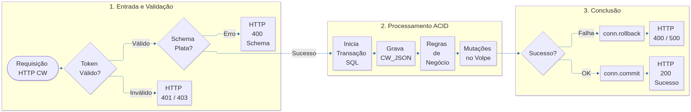
  </a>
</div>

### 2.1. Pilares Arquiteturais

1. **Garantia Transacional ACID:** Toda requisição que envolva múltiplos registros (ex: inclusão em `AG_FATURADO`, desdobramento em `FI_MOVFIN` e emissão de `FT_NSERVICOS`) é envolvida em uma única transação no banco. Qualquer erro intermediário desfaz 100% das alterações (`ROLLBACK`), impedindo inconsistências e dados órfãos.
2. **Consultas Parametrizadas & Proteção contra SQL Injection:** 100% das chamadas a banco utilizam construtores de queries parametrizadas (*Query Builder*). Não há concatenação crua de strings, garantindo estabilidade contra apóstrofes e caracteres especiais (ex: nomes de empresas internacionais como *"O'Reilly"* ou *"D'Agostini"*).
3. **Fail-Fast Estrutural:** O JSON recebido é validado por modelos estritos da Plata Runtime antes mesmo de abrir conexão com regras pesadas de negócio, poupando recursos e retornando apontamentos cirúrgicos dos campos com inconformidade.

---

## 3. Padrões de Comunicação, Autenticação & Políticas HTTP

### 3.1. Headers Obrigatórios

Todas as chamadas para os endpoints de negócio exigem os seguintes cabeçalhos HTTP:

| Header | Valor Esperado | Descrição |
| :--- | :--- | :--- |
| `Content-Type` | `application/json` | Define o formato de intercâmbio de dados |
| `x-access-token` | `Bearer <SEU_TOKEN_LOCAL>` | Chave de autenticação privada da API |

> [!WARNING]
> A ausência ou envio de token inválido no header `x-access-token` interrompe o processamento imediatamente com **HTTP 401/403**:
> ```json
> {
>   "errorID": "BRV1ALLINDEX001",
>   "msg": "Token inválido"
> }
> ```

### 3.2. Padrão de Status HTTP da API

| Status HTTP | Significado | Comportamento da API |
| :--- | :--- | :--- |
| <span class="badge badge-200">200 OK</span> | **Sucesso** | Operação realizada e comitada com sucesso no ERP Volpe. Retorna o ID gerado ou mensagem informativa de duplicidade já existente sem falhar a fila. |
| <span class="badge badge-400">400 Bad Request</span> | **Regra de Negócio / Validação** | Dados ausentes, filiais inexistentes, moedas sem câmbio ou incompatibilidade fiscal. A transação sofre rollback total. |
| <span class="badge badge-400">401 / 403</span> | **Falha de Acesso** | Falta de autenticação ou token incorreto. |
| <span class="badge badge-500">500 Server Error</span> | **Erro Crítico** | Falha de runtime, indisponibilidade do banco de dados ou erro inesperado (sempre acompanhado de rollback total). |

---

## 4. Módulo de Parceiros e CadÚnico — Account

<span class="badge badge-post">POST</span> `/v1/cargowise/Account`

### 4.1. Objetivo & Papel de Negócio

Sincronizar a base de parceiros (clientes, fornecedores, agentes no exterior e filiais intercompany) da CargoWise com a tabela mestre **`TB_CADUNICO`** do ERP Volpe. A API detecta automaticamente se o parceiro já existe, realizando uma unificação inteligente (`vincularCadunico`) ou inserindo um novo parceiro completo.

### 4.2. Fluxograma Operacional


<div align="center" style="margin: 25px 0;">
  <a href="https://raw.githubusercontent.com/MatheusRafaelPWI/Ventana_node_ApiCargoWise2.0/main/media/diagram_mermaid_2.svg" target="_blank" title="Clique para abrir em tela cheia (Vetor SVG)">
    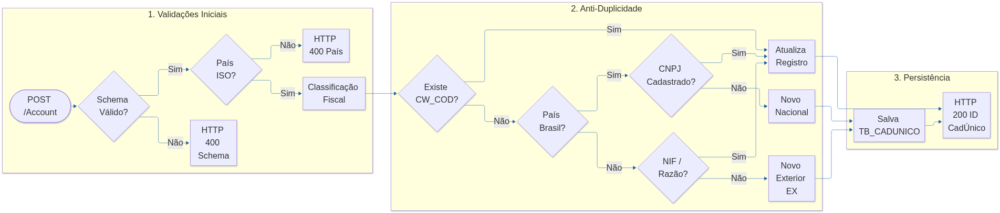
  </a>
</div>

### 4.3. Dicionário De-Para (`TB_CADUNICO`)

| Campo JSON (CargoWise) | Campo SQL (`TB_CADUNICO`) | Tipo | Regra e Observações |
| :--- | :--- | :--- | :--- |
| `CorporateAccountCode` | `CD_CARGOWISE` | VARCHAR(20) | Identificador exclusivo do parceiro na CargoWise. |
| `CompanyName` | `DS_RAZAO` | VARCHAR(70) | Razão Social (truncada em 70 caracteres em caixa alta). |
| `CompanyName` | `DS_FANTASIA` | VARCHAR(20) | Nome Fantasia (20 primeiros caracteres da Razão Social). |
| `Address.CountryCode` | `FK_PAIS` | VARCHAR(3) | Resolvido contra `TB_PAISES` via código ISO-2 ou ISO-3. |
| `Address.Zone` | `DS_UF` | VARCHAR(2) | UF do estado brasileiro. Para exterior, assume `'EX'`. |
| `Address.City` | `DS_CIDADE` | VARCHAR(30) | Cidade. Se não existir na UF, cadastra em `TB_CIDADES`. |
| `Address.Street` | `DS_ENDERECO` | VARCHAR(130)| Logradouro comercial. |
| `Address.ZipCode` | `DS_CEP` | VARCHAR(10) | Código postal / CEP. |
| `BankFinancialInfo.CNPJ` | `NR_CNPJ` | NUMERIC(14) | Apenas números do CNPJ/CPF. |
| `TaxRegime` | `FK_REGIMETRIBUTARIO` | INT | Regime Tributário (1=Simples, 3=Normal). Obrigatório para Brasil. |
| `NIFs` | `NR_NIF` | VARCHAR(30) | Número de Identificação Fiscal Estrangeiro. |
| *(Calculado)* | `FK_TIPO` | INT | 1 (Cliente), 2 (Fornecedor), 6 (Agente), 14 (Intercompany), 15 (Ambos). |

### 4.4. Regras Fiscais Brasileiras vs Exterior

> [!IMPORTANT]
> **Parceiros Nacionais (País = `BRA`):**
> * O campo `CNPJ` é **estritamente obrigatório**.
> * O campo `TaxRegime` deve ser numérico e corresponder a um registro ativo na tabela `TB_REGIMETRIBUTARIO`.
> * O campo `Address.Zone` deve conter a sigla oficial de 2 letras de um Estado brasileiro válido.
>
> **Parceiros Internacionais (País != `BRA`):**
> * O campo `CNPJ` é desconsiderado.
> * O campo `TaxRegime` deve ser omitido (`null`).
> * O campo `Address.Zone` assume automaticamente o valor `'EX'`.

### 4.5. Algoritmo Anti-Duplicidade

A API executa 3 camadas de busca antes de criar um novo registro:
1. **Busca por `CD_CARGOWISE`:** Se encontrar o código da conta, executa atualização dos dados (`vincularCadunico`).
2. **Busca por `NR_CNPJ` (Brasil):** Se o CNPJ já existir com outro código, associa o código CargoWise ao cadastro existente sem duplicar.
3. **Busca Heurística Exterior:** Para outros países, busca por combinação de País + Código Postal + Similaridade de Razão Social ou NIF.

### 4.6. Tabela Exaustiva de Retornos e Erros

| Código HTTP | Mensagem de Retorno | Causa Raiz | Como Corrigir |
| :--- | :--- | :--- | :--- |
| <span class="badge badge-400">400</span> | `"Invalid country code"` | País informado em `CountryCode` não existe na `TB_PAISES`. | Enviar código ISO válido (ex: `BRA`, `USA`, `ITA`, `DEU`). |
| <span class="badge badge-400">400</span> | `"Invalid classification."` | Nenhuma flag de cliente/fornecedor ativa. | Informar ao menos uma classificação válida na CargoWise. |
| <span class="badge badge-400">400</span> | `"CNPJ is missed"` | Parceiro brasileiro sem CNPJ ou com CNPJ nulo. | Preencher o CNPJ/CPF com 11 ou 14 dígitos numéricos. |
| <span class="badge badge-400">400</span> | `"TaxRegime obrigatório e deve ser numérico."` | Parceiro Brasil com Regime Tributário ausente. | Informar código numérico (ex: `1`, `3`). |
| <span class="badge badge-200">200</span> | `{"status": 200, "message": "Conta vinculada/criada com sucesso", "id": 12345}` | Operação persistida com sucesso. | Parceiro disponível no CadÚnico. |

### 4.7. Guia Prático de Testes & Evidências de Homologação (ERP Volpe)

#### Cenário 4.7.1: Cadastro de Parceiro Nacional (Padrão Brasil)

* **Endpoint:** `POST /v1/cargowise/Account`
* **Payload JSON:**

<details>
<summary><b>Clique para expandir e visualizar o payload JSON completo da requisição</b></summary>
<br>

> **Download do arquivo:** [`01_account_parceiro_nacional_request.json`](https://raw.githubusercontent.com/MatheusRafaelPWI/Ventana_node_ApiCargoWise2.0/main/json/01_account_parceiro_nacional_request.json)

```json
{
  "CorporateAccountCode": "CLI-WOLPAC-01",
  "CompanyName": "WOLPAC SISTEMAS DE CONTROLE LTDA",
  "IsClient": true,
  "IsSupplier": false,
  "Address": {
    "CountryCode": "BRA",
    "Zone": "SP",
    "City": "Ferraz de Vasconcelos",
    "District": "Vila Romanopolis",
    "Street": "Avenida Brasil, 1500",
    "ZipCode": "08500-000",
    "OtherInfo": "Bloco A"
  },
  "BankFinancialInfo": {
    "CNPJ": "02154879000185"
  },
  "TaxRegime": 3,
  "BusinessPhone": "(11) 4674-8800",
  "Email": "fiscal@wolpac.com.br"
}
```

</details>

* **Resposta Esperada:**


```json
{
  "status": 200,
  "message": "Conta inserida com sucesso.",
  "id": 36268
}
```

* **Evidência Visual no ERP Volpe (`TB_CADUNICO`):**
O registro é criado no módulo de Cadastros Gerais com todos os campos fiscais preenchidos:

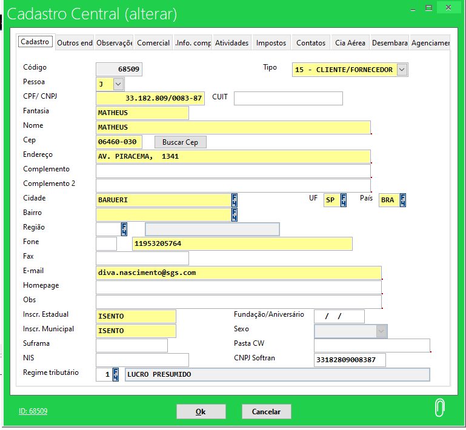

---

## 5. Módulo de Contas a Pagar — AP

<span class="badge badge-post">POST</span> `/v1/cargowise/AP`

### 5.1. Objetivo & Cenários Operacionais Suportados

Registrar no ERP Volpe as faturas de despesas operacionais e custos de fornecedores (armadores, cias aéreas, terminais, despachantes e agentes internacionais). Suporta:
* **Faturas Padrão com Rateio:** Cria título financeiro em `FI_MOVFIN`, rateios de centros de custo em `FI_MOVRAT`, processos em `AG_PROCESSO` e custos em `AG_PROCESSOTAXAS`.
* **Faturas com Moeda Estrangeira:** Converte montantes a pagar pela cotação enviada em `exchangeRate`.
* **Taxas com Baixa Automática:** Taxas que sofrem compensação direta.
* **Código 113 (OCTE / DCTE):** Fretes rodoviários com validação estrita em `TS_PARAMETROS`.
* **Estornos e Notas de Crédito (`creditNote: true`):** Desfaz títulos financeiros e grava liquidações em `FI_BAIXAS`.

### 5.2. Fluxograma Operacional (Inclusão e Estorno)


<div align="center" style="margin: 25px 0;">
  <a href="https://raw.githubusercontent.com/MatheusRafaelPWI/Ventana_node_ApiCargoWise2.0/main/media/diagram_mermaid_3.svg" target="_blank" title="Clique para abrir em tela cheia (Vetor SVG)">
    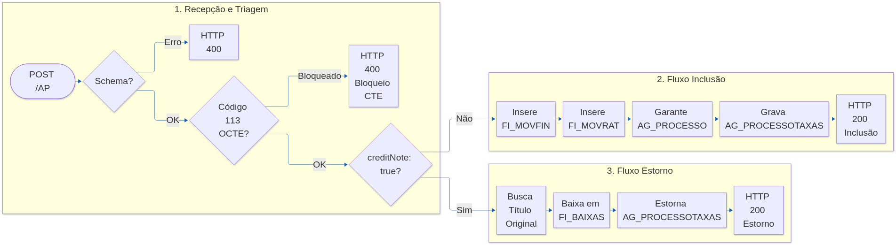
  </a>
</div>

### 5.3. Dicionário De-Para (`FI_MOVFIN` / `AG_PROCESSOTAXAS`)

| Campo JSON (CargoWise) | Campo SQL (`FI_MOVFIN`) | Regra de Transformação |
| :--- | :--- | :--- |
| `order.orderNumber` | `DS_INVOICE` | Número da fatura comercial do fornecedor. |
| `order.customerSupplierCode` | `FK_CADUNICO` | Fornecedor resolvido na `TB_CADUNICO`. |
| `order.orderDate` | `DT_EMISSAO` | Data de emissão da fatura (ajustada para dia útil). |
| `order.dueDate` | `DT_VENCTO` | Data de vencimento do compromisso a pagar. |
| `order.currency` | `FK_MOEDA` | Moeda (`BRL`, `USD`, `EUR`). Se != BRL, exige câmbio. |
| `order.exchangeRate` | `VL_CAMBIO` | Taxa cambial de conversão. |
| `items[].totalAmount` | `VL_BRUTO` / `VL_LIQUIDO` | Valor do compromisso a pagar. |
| `items[].erpInvoiceReference`| *(Busca de Título)* | Referência da fatura original utilizada no estorno. |
| `items[].shipmentsCharges` | `AG_PROCESSOTAXAS` | Taxas associadas ao custo do processo (`AG_PROCESSO`). |

### 5.4. Máscaras Fiscais, Moedas Estrangeiras e Câmbio

A API determina automaticamente a máscara fiscal contábil (`FI_MASCARAS`):
* **Fornecedor Internacional:** Utiliza máscara contábil de agentes internacionais (`AP-CW-AGENTES`).
* **Fornecedor Nacional:** Utiliza máscara de liquidação ou provisão nacional (`AP-CW-BR_LIQUIDACAO` ou `AP-CW-BR_PROVISAO`).
* **Moedas Estrangeiras:** Quando a moeda for diferente de `BRL`, a API exige o envio de `exchangeRate > 0`, convertendo os valores financeiros proporcionalmente.

### 5.5. Taxas Especiais: Baixa Automática e Código 113

> [!CAUTION]
> **Regras Restritivas do Contas a Pagar:**
> 1. **Taxas Diferenciadas com Baixa Automática:** Se qualquer item possuir taxa com `TG_BXAUTOMATICA = 1` no ERP Volpe, a requisição **deve conter exclusivamente esse item**. O envio misturado de taxa de baixa automática com outras taxas comuns é rejeitado com HTTP 400.
> 2. **Código 113 (OCTE / DCTE):** Exige flag de liberação na tabela `TS_PARAMETROS`. Caso o fornecedor não possua permissão de emissão de CTE, a requisição é bloqueada.

### 5.6. Fluxo de Estorno Financeiro (`creditNote: true`)

Quando a fatura for enviada com `"creditNote": true`:
1. O campo `items[].erpInvoiceReference` torna-se **mandatório**, pois identifica o número da fatura original emitida anteriormente.
2. A API localiza o título financeiro correspondente em `FI_MOVFIN` pelo fornecedor, filial e referência.
3. São gravados os registros de baixa de compensação na tabela `FI_BAIXAS`, anulando o contas a pagar original e estornando as despesas em `AG_PROCESSOTAXAS`.

### 5.7. Tabela Exaustiva de Retornos e Erros

| Código HTTP | Mensagem de Retorno | Causa Raiz | Como Corrigir |
| :--- | :--- | :--- | :--- |
| <span class="badge badge-400">400</span> | `"order.items não informado."` | Lista de itens vazia ou nula. | Enviar ao menos 1 item com `chargeCode` e valor. |
| <span class="badge badge-400">400</span> | `"Charge code diferenciado com baixa automatica deve ser enviado sozinho."` | Item de baixa automática misturado com outras taxas. | Isolar a taxa de baixa automática em uma requisição exclusiva. |
| <span class="badge badge-400">400</span> | `"Moeda estrangeira sem cotação"` | Fatura em USD/EUR com `exchangeRate` zerado ou ausente. | Informar o câmbio oficial no campo `exchangeRate`. |
| <span class="badge badge-400">400</span> | `"Cliente não encontrado."` | Fornecedor `customerSupplierCode` não localizado na `TB_CADUNICO`. | Cadastrar o fornecedor previamente via rota `/Account`. |
| <span class="badge badge-200">200</span> | `"Invoice: [XYZ] já foi incluída"` | Fatura com mesmo número já inserida anteriormente. | Informativo de idempotência: a fila segue sem falhas. |

### 5.8. Guia Prático de Testes & Evidências de Homologação (ERP Volpe)

#### Cenário 5.8.1: Inclusão de Fatura AP Padrão

* **Endpoint:** `POST /v1/cargowise/AP`
* **Payload JSON:**

<details>
<summary><b>Clique para expandir e visualizar o payload JSON completo da requisição</b></summary>
<br>

> **Download do arquivo:** [`02_ap_fatura_padrao_request.json`](https://raw.githubusercontent.com/MatheusRafaelPWI/Ventana_node_ApiCargoWise2.0/main/json/02_ap_fatura_padrao_request.json)

```json
{
  "order": {
    "orderNumber": "FAT-FORN-2026/01",
    "jobInvoiceNumber": "S26TRN052045",
    "orderDate": "2026-10-01T08:00:00",
    "orderType": 1,
    "creditNote": false,
    "currency": "BRL",
    "totalAmount": 1500.00,
    "customerSupplierCode": "WOLSOLBR",
    "crmAccountId": "397688",
    "exchangeRate": 1.0,
    "paymentTermsDays": 30,
    "paymentMethod": "TRF",
    "dueDate": "2026-10-31T08:00:00",
    "createInvoiceUserCode": "LHB",
    "createInvoiceUserName": "Leonardo Henrique",
    "items": [
      {
        "rowDescription": "Frete Internacional Aéreo",
        "chargeCode": "FRT",
        "quantity": 1,
        "unitAmount": 1500.00,
        "totalAmount": 1500.00,
        "currency": "BRL",
        "cumulative": false,
        "isCustomDuty": false,
        "chargeLineBranch": "REC",
        "chargeExchangeRate": 1.0,
        "shipmentsCharges": [
          {
            "shipmentNumber": "S26TRN052045",
            "division": 3,
            "shipmentType": "SPA",
            "chargeCode": "FRT",
            "amount": 1500.00,
            "isCustomDuty": false
          }
        ]
      }
    ],
    "shipmentsDimensions": [
      {
        "shipmentNumber": "S26TRN052045",
        "division": 3,
        "dimensionName": "ShipmentBranch",
        "dimensionValueType": 0,
        "dimensionValueString": "REC"
      },
      {
        "shipmentNumber": "S26TRN052045",
        "division": 3,
        "dimensionName": "Department",
        "dimensionValueType": 0,
        "dimensionValueString": "FIA"
      },
      {
        "shipmentNumber": "S26TRN052045",
        "division": 3,
        "dimensionName": "CompetenceDate",
        "dimensionValueType": 2,
        "dimensionValueDate": "2026-09-22T18:00:00"
      },
      {
        "shipmentNumber": "S26TRN052045",
        "division": 3,
        "dimensionName": "MasterBill",
        "dimensionValueType": 0,
        "dimensionValueString": "020-25591311"
      },
      {
        "shipmentNumber": "S26TRN052045",
        "division": 3,
        "dimensionName": "HouseBill",
        "dimensionValueType": 0,
        "dimensionValueString": "26TRN052045"
      },
      {
        "shipmentNumber": "S26TRN052045",
        "division": 3,
        "dimensionName": "IncoTerm",
        "dimensionValueType": 0,
        "dimensionValueString": "FCA"
      }
    ]
  }
}
```

</details>

* **Resposta da API:**


```json
{
  "status": 200,
  "message": "Fatura AP incluída com sucesso.",
  "id": 854120
}
```

* **Evidências Visuais no ERP Volpe:**

1. **Título Financeiro em `FI_MOVFIN` e Rateio Contábil em `FI_MOVRAT`:**
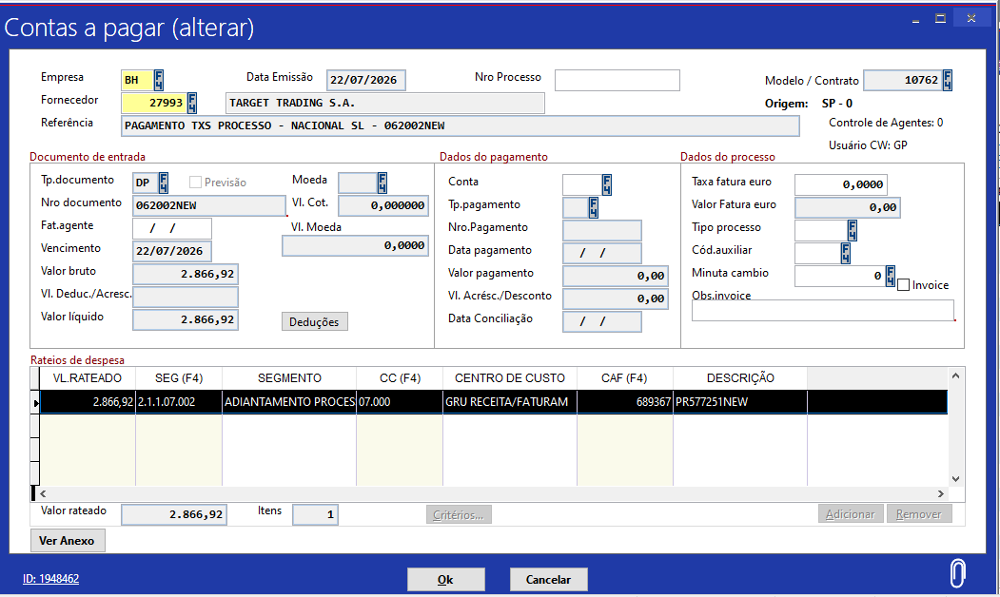

2. **Processo Operacional Associado em `AG_PROCESSO`:**
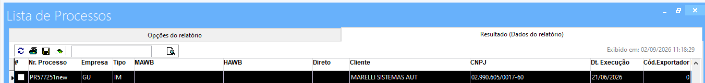

3. **Custos Operacionais do Embarque em `AG_PROCESSOTAXAS`:**
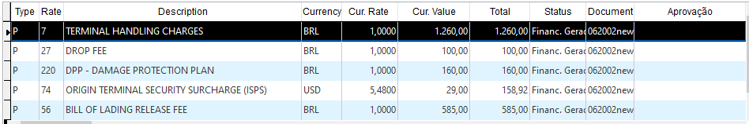

---

#### Cenário 5.8.2: Estorno de Fatura AP Padrão (`creditNote: true`)

* **Endpoint:** `POST /v1/cargowise/AP`
* **Destaques do Payload:**
  * `"creditNote": true`
  * `items[0].erpInvoiceReference`: `"FAT-FORN-2026/01"` (fatura original a ser cancelada).

* **Evidências Visuais no ERP Volpe:**

1. **Baixa e Cancelamento do Título em `FI_MOVFIN` (Contas a Pagar):**
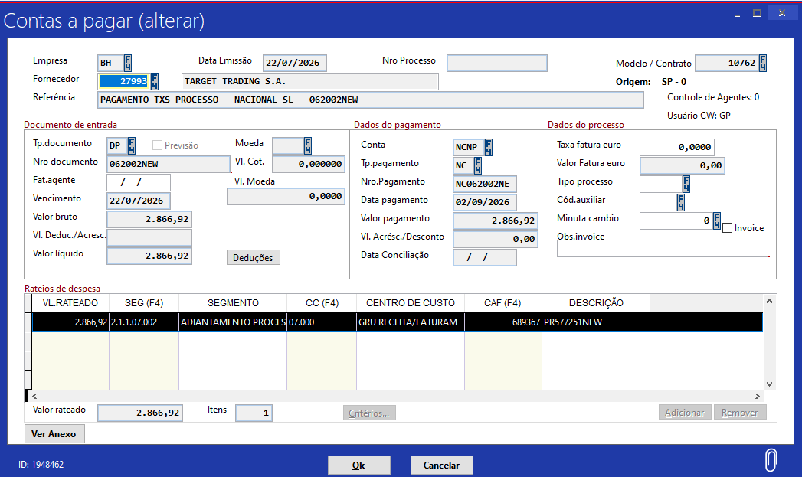

2. **Registro de Compensação em `FI_BAIXAS`:**
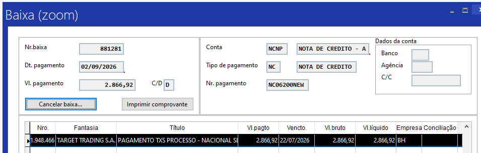

3. **Reversão das Taxas em `AG_PROCESSOTAXAS`:**
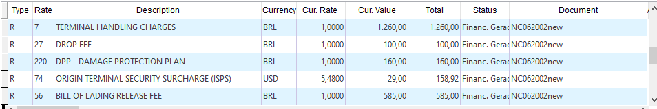

---

#### Cenário 5.8.3: Fatura Internacional Multi-Processos em Moeda Estrangeira (Caso Real Homologado)

* **Endpoint:** `POST /v1/cargowise/AP`
* **Documento / Invoice:** `00062840MAT4` (ID ERP Volpe: `1953450` | Tp. Doc: `DP`)
* **Referência Volpe:** `PAGAMENTO TXS PROCESSO - AGENTES PL - 00062840MAT4` (Modelo/Contrato: `10760` | Origem: `SP - 0`)
* **Fornecedor:** `42463 - VENTANA SERRA MIAMI` (`customerSupplierCode: "VENSERUS"` | Empresa: `AG`)
* **Moeda:** `USD` | **Cotação Oficial (Vl. Cot.):** `5,113876`
* **Valores Homologados no ERP Volpe:**
  * **Valor Moeda Estrangeira (Vl. Moeda):** `$ 84.346,85 USD` (`84346,8500`)
  * **Valor Bruto / Líquido / Rateado:** `R$ 431.339,31`
* **Datas da Operação:** Emissão: `07/10/2026` | Vencimento: `06/11/2026` | Usuário CW: `CRU`
* **Destaques Arquiteturais & Volumetria:**
  * Fatura de alta complexidade contendo **261 itens de encargos** (conforme registrado no campo *Itens: 261* do ERP Volpe) distribuídos entre **58 processos operacionais** distintos (`S26CHI015873`, `S26CHI020938`, `S26CHI022448`, `S26GRU...`, `S26MIA...`, etc.).
  * Consolidação contábil no centro de custo operacional da filial executora (`02.000` / `BHZ RECEITA/FATURAM`) com o segmento contábil da máscara de agentes (`5.1.4.01.002` - `AGENTES A PAGAR`).
  * Demonstra a paridade integral e a robustez transacional da API ao converter múltiplos câmbios de itens e consolidar o valor bruto exato de R$ 431.339,31 no financeiro e no valor rateado.
* **Payload JSON:**

<details>
<summary><b>Clique para expandir e visualizar o payload JSON da requisição (Estrutura Real Homologada)</b></summary>
<br>

> **Download do arquivo integral (18.853 linhas / 567 KB):** [`03_ap_fatura_multiprocesso_real.json`](https://raw.githubusercontent.com/MatheusRafaelPWI/Ventana_node_ApiCargoWise2.0/main/json/03_ap_fatura_multiprocesso_real.json)

```json
{
  "order": {
    "orderNumber": "00032127/00062840/AP/20261007",
    "jobInvoiceNumber": "",
    "orderDate": "2026-10-07T00:00:00",
    "orderType": 1,
    "creditNote": false,
    "currency": "USD",
    "totalAmount": null,
    "customerSupplierCode": "VENSERUS",
    "crmAccountId": "340483",
    "exchangeRate": 5.113876,
    "paymentTermsDays": 30,
    "paymentMethod": "TRF",
    "dueDate": "2026-11-06T09:03:00",
    "createInvoiceUserCode": "CRU",
    "createInvoiceUserName": "Cinzia Rubino",
    "_comentario_volumetria": "Fatura real contendo 261 itens de encargos distribuídos em 58 processos operacionais (totalizando R$ 431.339,31 e ID 1953450 no ERP Volpe). Exibindo os 2 primeiros itens abaixo:",
    "items": [
      {
        "rowDescription": "Handling Charges",
        "costItem": null,
        "chargeCode": "OHAN",
        "vatCode": null,
        "um": null,
        "quantity": 1,
        "unitAmount": 175,
        "totalAmount": 175,
        "currency": "USD",
        "cumulative": false,
        "competenceDateStart": "2026-08-25T00:00:00",
        "competenceDateEnd": "2026-08-25T00:00:00",
        "erpInvoiceReference": null,
        "erpInvoiceReferenceDate": null,
        "isCustomDuty": false,
        "chargeLineBranch": "BHZ",
        "chargeExchangeRate": 5.011886,
        "shipmentsCharges": [
          {
            "shipmentNumber": "S26CHI015873",
            "division": 4,
            "shipmentType": "SPM",
            "chargeCode": "OHAN",
            "amount": 175,
            "isCustomDuty": false
          }
        ],
        "rowNotes": [],
        "taxes": [],
        "IBS_CBS": {}
      },
      {
        "rowDescription": "VGM Transmission",
        "costItem": null,
        "chargeCode": "OVGM",
        "vatCode": null,
        "um": null,
        "quantity": 1,
        "unitAmount": 10,
        "totalAmount": 10,
        "currency": "USD",
        "cumulative": false,
        "competenceDateStart": "2026-08-25T00:00:00",
        "competenceDateEnd": "2026-08-25T00:00:00",
        "erpInvoiceReference": null,
        "erpInvoiceReferenceDate": null,
        "isCustomDuty": false,
        "chargeLineBranch": "BHZ",
        "chargeExchangeRate": 5.012,
        "shipmentsCharges": [
          {
            "shipmentNumber": "S26CHI015873",
            "division": 4,
            "shipmentType": "SPM",
            "chargeCode": "OVGM",
            "amount": 10,
            "isCustomDuty": false
          }
        ],
        "rowNotes": [],
        "taxes": [],
        "IBS_CBS": {}
      },
      "... [mais 260 itens de encargos idênticos nos outros 56 processos operacionais. Baixe o JSON completo abaixo para o arquivo de 18.853 linhas] ..."
    ],
    "shipmentsDimensions": [
      {
        "shipmentNumber": "S26CHI015873",
        "division": 4,
        "dimensionName": "ServiceType",
        "dimensionValueType": 2,
        "dimensionValueString": null,
        "dimensionValueNumeric": null,
        "dimensionValueDate": "2026-08-25T00:00:00"
      },
      {
        "shipmentNumber": "S26CHI015873",
        "division": 4,
        "dimensionName": "CompetenceDate",
        "dimensionValueType": 2,
        "dimensionValueString": null,
        "dimensionValueNumeric": null,
        "dimensionValueDate": "2026-05-06T00:00:00"
      },
      {
        "shipmentNumber": "S26CHI015873",
        "division": 4,
        "dimensionName": "AirportDepartureCountry",
        "dimensionValueType": 0,
        "dimensionValueString": "USA",
        "dimensionValueNumeric": null,
        "dimensionValueDate": null
      },
      {
        "shipmentNumber": "S26CHI015873",
        "division": 4,
        "dimensionName": "DestinationCountry",
        "dimensionValueType": 0,
        "dimensionValueString": "BRA",
        "dimensionValueNumeric": null,
        "dimensionValueDate": null
      },
      {
        "shipmentNumber": "S26CHI015873",
        "division": 4,
        "dimensionName": "SenderCountry",
        "dimensionValueType": 0,
        "dimensionValueString": "USA",
        "dimensionValueNumeric": null,
        "dimensionValueDate": null
      },
      {
        "shipmentNumber": "S26CHI015873",
        "division": 4,
        "dimensionName": "ArrivalPortCountry",
        "dimensionValueType": 0,
        "dimensionValueString": "BRA",
        "dimensionValueNumeric": null,
        "dimensionValueDate": null
      },
      "... [dimensões de todos os processos operacionais vinculados] ..."
    ]
  }
}
```

</details>

* **Resposta da API:**

```json
{
  "status": 200,
  "message": "Invoice incluída com sucesso.",
  "id": 1953450
}
```

* **Evidência Operacional no ERP Volpe (`Contas a pagar - ALTERAR`):**
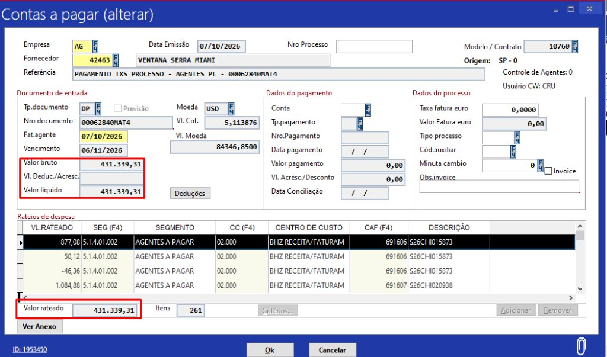

> [!NOTE]
> **Tratamento de Serviços sem De-Para em `AG_SERVICOS`:**
> No módulo AP, caso um encargo recebido (ex: `PF` - Processing Fee) não possua amarração cadastrada para o modal do processo na tabela `AG_SERVICOS`, a API não rejeita a fatura financeira (`FI_MOVFIN` e `FI_MOVRAT` são gravados pelo total integral). O item apenas não gera linha de taxa em `AG_PROCESSOTAXAS`, e a API retorna `HTTP 200` com a mensagem informativa no campo `aviso`.

---

## 6. Módulo de Contas a Receber e Faturamento — AR

<span class="badge badge-post">POST</span> `/v1/cargowise/AR`

### 6.1. Objetivo & Desdobramentos Fiscais

O módulo AR é o coração financeiro e fiscal da integração da Ventana Serra. Ao faturar um cliente na CargoWise, a API executa um fluxo completo e orquestrado:
1. Registra o faturamento mestre na tabela **`AG_FATURADO`**.
2. Cria os títulos a receber no **`FI_MOVFIN`**, segregando receitas tributadas, não-tributadas (reembolsos) e em moeda estrangeira.
3. Processa e valida o novo bloco da **Reforma Tributária Brasileira (`IBS_CBS`)**.
4. Emite e formata as **Notas Fiscais de Serviço (NFS-e)** nas tabelas **`FT_NSERVICOS`** e **`FT_NSITENS`**, calculando retenções federais (PIS, COFINS, CSLL, IRRF) e municipal (ISS).
5. Calcula a transparência fiscal exigida pela Lei Federal do **IBPT**.

### 6.2. Fluxograma Operacional (Faturamento à Emissão de NFS-e)


<div align="center" style="margin: 25px 0;">
  <a href="https://raw.githubusercontent.com/MatheusRafaelPWI/Ventana_node_ApiCargoWise2.0/main/media/diagram_mermaid_4.svg" target="_blank" title="Clique para abrir em tela cheia (Vetor SVG)">
    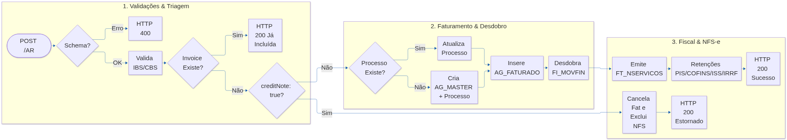
  </a>
</div>

### 6.3. Dicionário De-Para (`AG_FATURADO` / `FI_MOVFIN` / `FT_NSERVICOS`)

| Campo JSON (CargoWise) | Campo SQL Destino | Tabela Destino | Papel no Negócio |
| :--- | :--- | :--- | :--- |
| `order.orderNumber` | `DS_INVOICE` | `AG_FATURADO` / `FI_MOVFIN` | Extrai a fatura comercial (ex: `2026/AUG404501/AR`  `AUG404501`). |
| `order.crmAccountId` | `FK_CADUNICO` | `AG_FATURADO` / `FI_MOVFIN` | Cliente cobrado no faturamento. |
| `order.orderDate` | `DT_PROCESSO` | `AG_FATURADO` | Data da operação (ajustada para dia útil em caso de fechamento contábil). |
| `order.dueDate` | `DT_VENCIMENTO` | `AG_FATURADO` / `FI_MOVFIN` | Vencimento financeiro do boleto/cobrança. |
| `order.paymentTermsDays` | `FK_FPAGTO` | `AG_FATURADO` | Forma de pagamento resolvida contra `TB_FPAGTOS` (pelo n° de dias). |
| `dimensions.OriginCountry` | `FK_PAISORIGEM` | `AG_FATURADO` | País de origem da carga resolvido contra `TB_PAISES`. |
| `dimensions.DestinationCountry`| `FK_PAISDESTINO`| `AG_FATURADO` | País de destino da carga resolvido contra `TB_PAISES`. |
| `dimensions.Department` | `FK_TIPO` | `AG_PROCESSO` | Modal operacional (`FIA` = Aéreo Imp, `FIE` = Marítimo Imp). |
| `dimensions.ShipmentBranch` | `FK_EMPRESA` | `AG_FATURADO` | Filial executora do faturamento (`REC`, `BH`, `SP`, `VIX`). |
| `dimensions.HouseBill` | `DS_HAWB` | `AG_FATURADO` / `AG_PROCESSO` | Conhecimento de embarque House. |
| `dimensions.MasterBill` | `DS_MAWB` | `AG_FATURADO` / `AG_PROCESSO` | Conhecimento de embarque Master (MAWB/BL). |
| `items[].chargeCode` | `FK_PRODUTO` | `AG_PROCESSOTAXAS` / `FT_NSITENS`| Código do serviço prestado. |
| `items[].taxes` | `FI_MOVIMP` / `FT_NSITENS` | Múltiplas | Retenções municipais (ISS) e federais (PIS, COFINS, IRRF, CSLL). |
| `items[].IBS_CBS` | `FT_NSERVICOS` / `FT_NSITENS`| Múltiplas | Dados e alíquotas da Reforma Tributária Nacional. |

### 6.4. Desdobramento Financeiro (Tributados, Reembolsos e Moedas Estrangeiras)

A API automatiza a segregação financeira em `FI_MOVFIN`:
1. **Fatura em Moeda Nacional (`BRL`):**
   * **Montante Tributado (`vlTotalTrib`):** Itens com impostos informados em `taxes` compõem a receita tributada. Se `vlTotalTrib > 0`, é gerado um título a receber deduzindo os impostos retidos.
   * **Montante Não Tributado (`vlTotalNaoTrib`):** Itens sem retenção de impostos (reembolsos e adiantamentos operacionais) compõem um segundo título financeiro líquido separado.
2. **Fatura em Moeda Estrangeira (`USD`, `EUR`):**
   * A API agrupa os itens por moeda e gera títulos financeiros convertendo pelo câmbio oficial informado em `order.exchangeRate`.

### 6.5. A Reforma Tributária Brasileira (`IBS_CBS`)

> [!IMPORTANT]
> **Validação do Bloco `IBS_CBS` em conformidade com a Reforma Tributária:**
>
> 1. **Itens Isentos (Sem Impostos):** Quando `items[].taxes` for vazio, o bloco `IBS_CBS` deve ser informado com valores **zerados**. A presença de alíquotas em itens não tributados acarreta erro: `"Bloco IBS_CBS deve estar zerado."`
> 2. **Itens Tributados (Com Impostos):** Quando `items[].taxes` for informado, o bloco `IBS_CBS` torna-se **mandatório**, exigindo:
>    * `TributacaoRegular`
>    * `CreditoPresumido`
>    * `ComprasGovernamentais`
>    * Validação da `SituacaoTributaria` contra a tabela `TB_CLATRIBIBSCBS`.
>    * Validação da `ClassificacaoTributaria` contra a tabela `TB_CLASERV`.

### 6.6. Emissão Fiscal de Notas de Serviço e Transparência IBPT

Para cada classificação fiscal dos itens tributados:
* É gerado o cabeçalho fiscal da Nota de Serviço em **`FT_NSERVICOS`** vinculado à filial (`chargeLineBranch`).
* São inseridos os itens de nota em **`FT_NSITENS`**, abatendo os percentuais de retenção de ISS, PIS, COFINS e IRRF.
* O sistema consulta e grava os valores aproximados de tributos municipais, estaduais e federais com base na tabela oficial do **IBPT**.

### 6.7. Fluxo de Estorno de Faturamento (`creditNote: true`)

Quando o faturamento for cancelado na CargoWise e reenviado com `"creditNote": true`:
1. A API verifica se a fatura já possui lançamentos contábeis fechados em `CT_LANCAB`.
2. Cancela os títulos a receber em `FI_MOVFIN`, registrando as baixas de compensação em `FI_BAIXAS`.
3. Reverte os custos associados em `AG_PROCESSOTAXAS`.
4. Exclui a Nota de Serviço pendente em `FT_NSERVICOS` e `FT_NSITENS` (caso ainda não tenha sido transmitida à prefeitura).
5. Marca o registro mestre de faturamento em `AG_FATURADO` como estornado.

### 6.8. Tabela Exaustiva de Retornos e Erros

| Código HTTP | Mensagem de Retorno | Causa Raiz | Como Corrigir |
| :--- | :--- | :--- | :--- |
| <span class="badge badge-400">400</span> | `"ShipmentBranch inválido"` | Filial da operação não localizada na `TB_EMPRESAS`. | Informar filial válida (`REC`, `BH`, `SP`, `VIX`). |
| <span class="badge badge-400">400</span> | `"País de origem inválido"` | Código ISO de país inexistente na `TB_PAISES`. | Informar código ISO-3 válido (ex: `ITA`, `BRA`). |
| <span class="badge badge-400">400</span> | `"Charge Code [XYZ] divergente do Department [FIA]"` | Código de taxa não cadastrado para o modal aéreo/marítimo. | Verificar se o serviço está homologado para o modal na tabela `AG_SERVICOS`. |
| <span class="badge badge-400">400</span> | `"Charge Code [XYZ] sem classificação"` | Produto sem amarração com filial em `FT_CLASERVPRODUTOS`. | Cadastrar a classificação fiscal do serviço para a filial. |
| <span class="badge badge-400">400</span> | `"Bloco IBS_CBS deve estar zerado."` | Itens sem imposto enviados com valores no bloco de reforma tributária. | Zerar campos de alíquota e valor do `IBS_CBS` em itens isentos. |
| <span class="badge badge-400">400</span> | `"SituacaoTributaria inválida: [XX]"` | Situação tributária inexistente na tabela `TB_CLATRIBIBSCBS`. | Informar código CST oficial de IBS/CBS. |
| <span class="badge badge-400">404</span> | `"Customer not found"` | Cliente faturado não localizado na `TB_CADUNICO`. | Cadastrar o cliente antes de realizar o faturamento. |
| <span class="badge badge-200">200</span> | `"Invoice: [XYZ] já foi incluída"` | Faturamento já processado no ERP Volpe. | Idempotência garantida sem gerar duplicidade. |

### 6.9. Guia Prático de Testes & Evidências de Homologação (ERP Volpe)

#### Cenário 6.9.1: Faturamento AR Padrão (Com Emissão de NFS-e)

* **Endpoint:** `POST /v1/cargowise/AR`
* **Exemplo de Payload com Múltiplas Taxas, Retenções e Dimensões:**

<details>
<summary><b>Clique para expandir e visualizar o payload JSON completo da requisição</b></summary>
<br>

> **Download do arquivo:** [`04_ar_faturamento_nfse_request.json`](https://raw.githubusercontent.com/MatheusRafaelPWI/Ventana_node_ApiCargoWise2.0/main/json/04_ar_faturamento_nfse_request.json)

```json
{
  "order": {
    "orderNumber": "2026/AUG404501/AR",
    "jobInvoiceNumber": "S26TRN052045",
    "orderDate": "2026-10-01T08:41:00",
    "orderType": 0,
    "creditNote": false,
    "currency": "BRL",
    "customerSupplierCode": "WOLSOLBR",
    "crmAccountId": "397688",
    "exchangeRate": 1.0,
    "paymentTermsDays": 30,
    "paymentMethod": "TRF",
    "dueDate": "2026-10-31T08:41:00",
    "createInvoiceUserCode": "LHB",
    "createInvoiceUserName": "Leonardo Henrique",
    "items": [
      {
        "rowDescription": "International Freight",
        "chargeCode": "FRT",
        "quantity": 1,
        "unitAmount": 1331.89,
        "totalAmount": 1331.89,
        "currency": "BRL",
        "cumulative": false,
        "isCustomDuty": false,
        "chargeLineBranch": "REC",
        "chargeExchangeRate": 1.0,
        "shipmentsCharges": [
          {
            "shipmentNumber": "S26TRN052045",
            "division": 3,
            "shipmentType": "SPA",
            "chargeCode": "FRT",
            "amount": 1331.89,
            "isCustomDuty": false
          }
        ],
        "taxes": [],
        "IBS_CBS": {
          "SituacaoTributaria": "",
          "ClassificacaoTributaria": "",
          "BaseCalculo": 0,
          "TotalIBS": 0,
          "ValorTotalIBS_CBS_IS": 0
        }
      },
      {
        "rowDescription": "Collect Fee",
        "chargeCode": "CCLFEE",
        "quantity": 1,
        "unitAmount": 70.59,
        "totalAmount": 70.59,
        "currency": "BRL",
        "cumulative": false,
        "isCustomDuty": false,
        "chargeLineBranch": "REC",
        "chargeExchangeRate": 1.0,
        "shipmentsCharges": [
          {
            "shipmentNumber": "S26TRN052045",
            "division": 3,
            "shipmentType": "SPA",
            "chargeCode": "CCLFEE",
            "amount": 70.59,
            "isCustomDuty": false
          }
        ],
        "taxes": [
          {
            "taxCode": "ISS",
            "taxRate": 5.0,
            "localTaxBase": 70.59,
            "localTaxAmount": -3.53
          },
          {
            "taxCode": "PCOFIN",
            "taxRate": 7.6,
            "localTaxBase": 70.59,
            "localTaxAmount": -5.36
          },
          {
            "taxCode": "PPIS",
            "taxRate": 1.65,
            "localTaxBase": 70.59,
            "localTaxAmount": -1.16
          },
          {
            "taxCode": "IRRF",
            "taxRate": 1.5,
            "localTaxBase": 70.59,
            "localTaxAmount": -1.06
          }
        ],
        "IBS_CBS": {
          "SituacaoTributaria": "",
          "ClassificacaoTributaria": "",
          "BaseCalculo": 70.59,
          "TotalIBS": 0.07,
          "ValorTotalIBS_CBS_IS": 0.71,
          "IBS_UF": {
            "AliquotaIBS_UF": 0.1,
            "ValorIBS_UF": 0.07
          },
          "CBS": {
            "AliquotaCBS": 0.9,
            "ValorCBS": 0.64
          },
          "TributacaoRegular": "Tributação Normal",
          "CreditoPresumido": "Sem crédito presumido",
          "ComprasGovernamentais": "Não aplicável"
        }
      }
    ],
    "shipmentsDimensions": [
      {
        "shipmentNumber": "S26TRN052045",
        "division": 3,
        "dimensionName": "ShipmentBranch",
        "dimensionValueType": 0,
        "dimensionValueString": "REC"
      },
      {
        "shipmentNumber": "S26TRN052045",
        "division": 3,
        "dimensionName": "Department",
        "dimensionValueType": 0,
        "dimensionValueString": "FIA"
      },
      {
        "shipmentNumber": "S26TRN052045",
        "division": 3,
        "dimensionName": "OriginCountry",
        "dimensionValueType": 0,
        "dimensionValueString": "ITA"
      },
      {
        "shipmentNumber": "S26TRN052045",
        "division": 3,
        "dimensionName": "DestinationCountry",
        "dimensionValueType": 0,
        "dimensionValueString": "BRA"
      },
      {
        "shipmentNumber": "S26TRN052045",
        "division": 3,
        "dimensionName": "CompetenceDate",
        "dimensionValueType": 2,
        "dimensionValueDate": "2026-09-22T18:00:00"
      },
      {
        "shipmentNumber": "S26TRN052045",
        "division": 3,
        "dimensionName": "MasterBill",
        "dimensionValueType": 0,
        "dimensionValueString": "020-25591311"
      },
      {
        "shipmentNumber": "S26TRN052045",
        "division": 3,
        "dimensionName": "HouseBill",
        "dimensionValueType": 0,
        "dimensionValueString": "26TRN052045"
      },
      {
        "shipmentNumber": "S26TRN052045",
        "division": 3,
        "dimensionName": "IncoTerm",
        "dimensionValueType": 0,
        "dimensionValueString": "FCA"
      }
    ]
  }
}
```

</details>

* **Resposta da API:**


```json
{
  "status": 200,
  "message": "Faturamento AR incluído com sucesso.",
  "id": 648599
}
```

* **Evidências Visuais no ERP Volpe:**

1. **Títulos Financeiros Desdobrados em `FI_MOVFIN` (Tributado e Reembolso):**
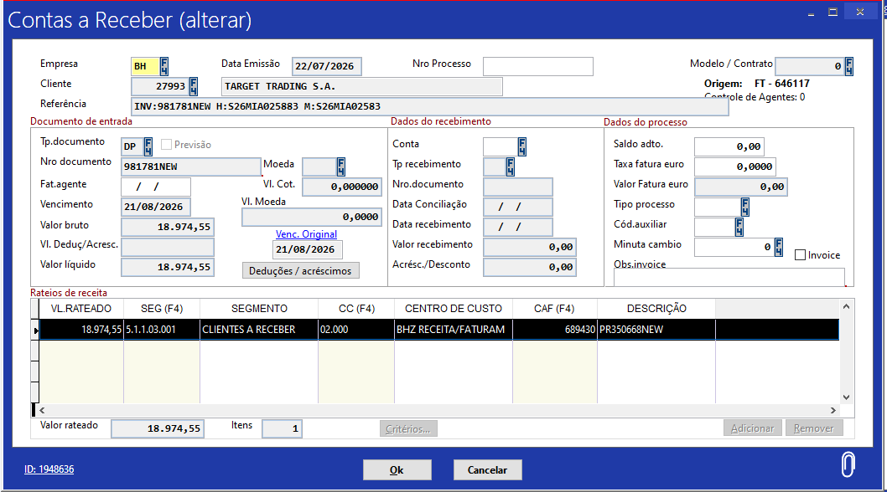

2. **Cabeçalho da Nota Fiscal de Serviço Emitida (`FT_NSERVICOS`):**
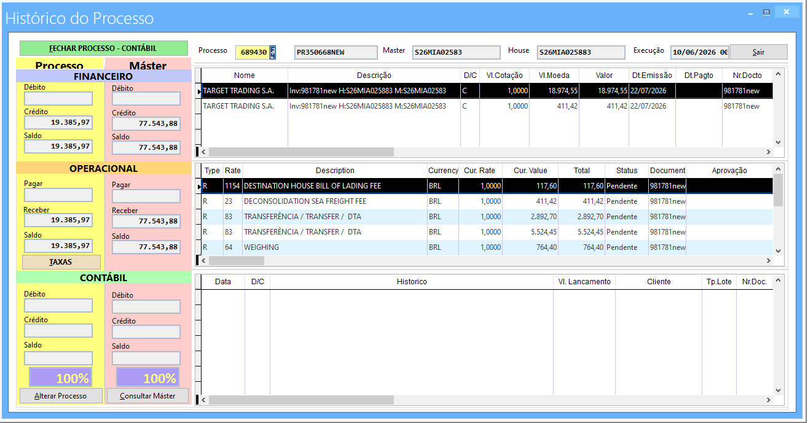

3. **Itens Tributados e Retenções de Impostos (`FT_NSITENS`):**
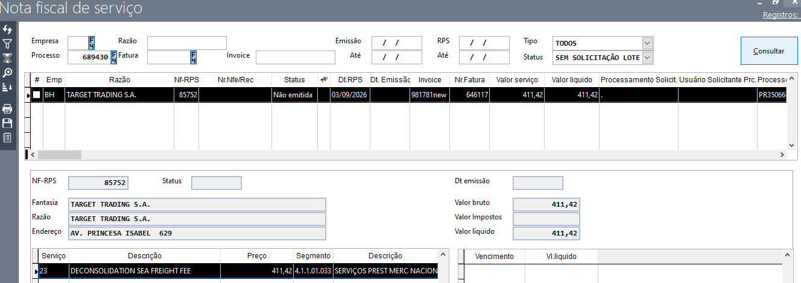

4. **Faturamento Mestre em `AG_FATURADO`:**
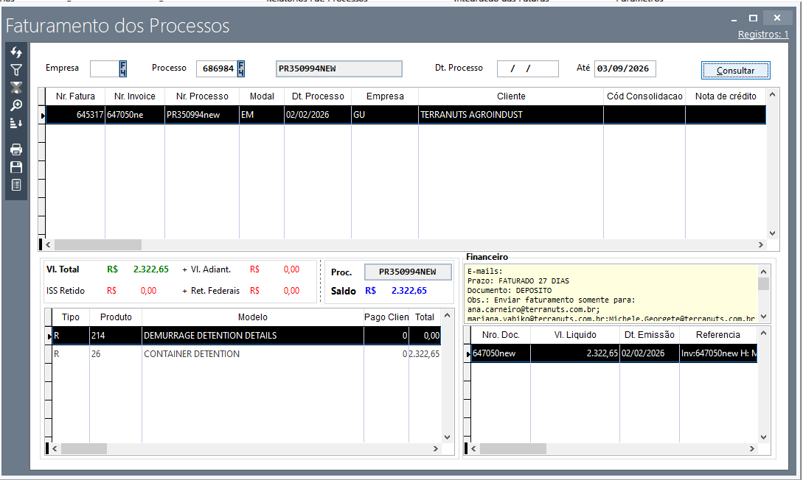

---

#### Cenário 6.9.2: Estorno de Faturamento AR Padrão (`creditNote: true`)

* **Endpoint:** `POST /v1/cargowise/AR`
* **Destaques do Payload:** `"creditNote": true`, enviando o número da invoice que sofrerá estorno.
* **Evidências Visuais no ERP Volpe:**

1. **Baixa e Desfazimento do Contas a Receber (`FI_BAIXAS`):**
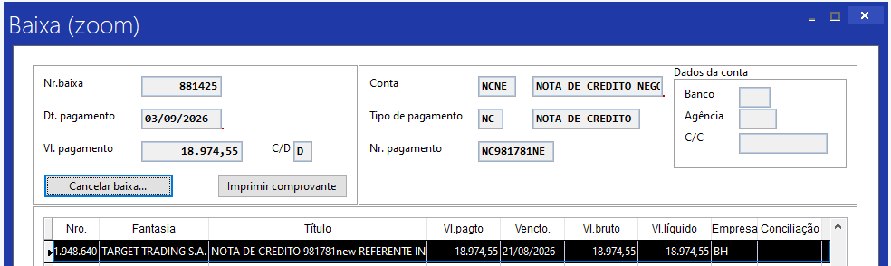

2. **Cancelamento / Exclusão da Nota Fiscal de Serviço (`FT_NSERVICOS`):**
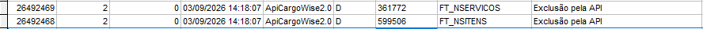

3. **Faturamento Marcado como Cancelado em `AG_FATURADO`:**
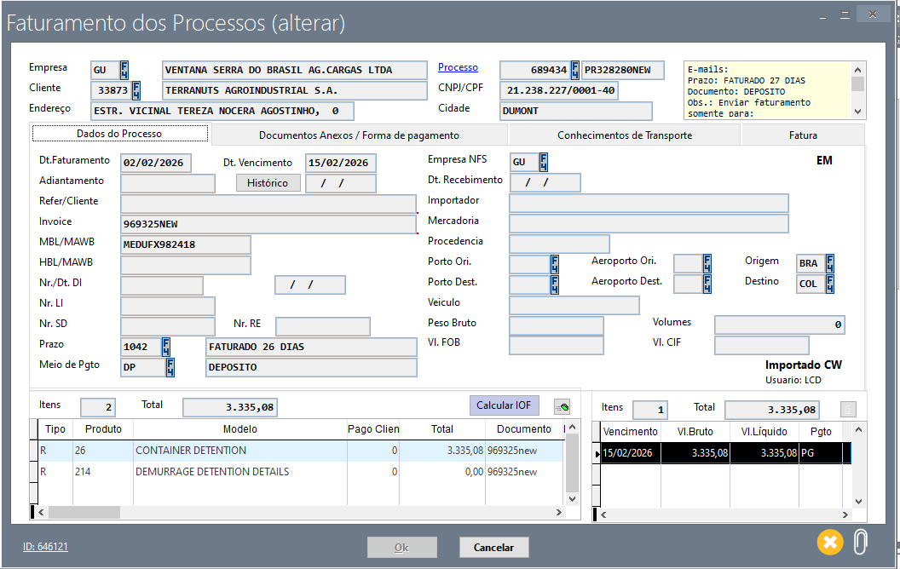

---

## 7. Módulo de Contratos Comerciais — Contract

<span class="badge badge-post">POST</span> `/v1/cargowise/Contract`

### 7.1. Objetivo & Papel Comercial

Registrar os termos e protocolos comerciais pactuados na CargoWise, atualizando as Inscrições Estaduais (IE) e Municipais (IM) do cliente na `TB_CADUNICO` e vinculando o vendedor/executivo de contas (Kam) cadastrado na tabela de comerciais `AG_COMERCIAL`.

### 7.2. Fluxograma Operacional


<div align="center" style="margin: 25px 0;">
  <a href="https://raw.githubusercontent.com/MatheusRafaelPWI/Ventana_node_ApiCargoWise2.0/main/media/diagram_mermaid_5.svg" target="_blank" title="Clique para abrir em tela cheia (Vetor SVG)">
    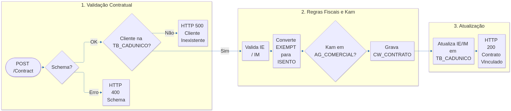
  </a>
</div>

### 7.3. Dicionário De-Para (`CW_CONTRATO` / `TB_CADUNICO`)

| Campo JSON (CargoWise) | Campo SQL Destino | Tabela Destino | Regra |
| :--- | :--- | :--- | :--- |
| `CorporateAccountCode` | `FK_CADUNICO` | `CW_CONTRATO` / `TB_CADUNICO` | Identificador do cliente parceiro. |
| `ContractNumber` | `DS_CONTRATO` | `CW_CONTRATO` | Número do contrato comercial. |
| `BrazilRegistrationIE` | `NR_INSCREST` | `TB_CADUNICO` | Inscrição Estadual (trata `"EXEMPT"` como `"ISENTO"`). |
| `BrazilRegistrationIM` | `NR_INSCRMUN` | `TB_CADUNICO` | Inscrição Municipal (obrigatório, não nulo). |
| `RepresentativeEmail` | `FK_COMERCIAL` | `TB_CADUNICO` | Resolvido contra `AG_COMERCIAL` pelo e-mail do Kam. |

### 7.4. Regras Fiscais: IE, IM, "EXEMPT"  "ISENTO" e Kam

> [!TIP]
> * **Inscrição Estadual com "EXEMPT":** Clientes que não possuem IE por atuarem exclusivamente no setor de serviços recebem a flag estrangeira `"EXEMPT"` na CargoWise. A API traduz esse texto automaticamente para `"ISENTO"`, adequando o campo às regras do fisco brasileiro.
> * **Representante Comercial:** Se o e-mail do vendedor informado em `RepresentativeEmail` não for localizado na tabela `AG_COMERCIAL`, a operação **não é abortada**. O contrato é registrado e o cliente é atualizado normalmente, emitindo aviso informativo de auditoria.

### 7.5. Tabela Exaustiva de Retornos e Erros

| Código HTTP | Mensagem de Retorno | Causa Raiz | Como Corrigir |
| :--- | :--- | :--- | :--- |
| <span class="badge badge-400">400</span> | `"BrazilRegistrationIE not found."` | Campo de Inscrição Estadual ausente no payload. | Enviar a IE ou o valor `"ISENTO"` / `"EXEMPT"`. |
| <span class="badge badge-400">400</span> | `"BrazilRegistrationIM can't be null."` | Campo de Inscrição Municipal enviado como nulo. | Preencher com o número da IM ou valor `"ISENTO"`. |
| <span class="badge badge-500">500</span> | `"Falha de localização de cliente na TB_CADUNICO"` | `CorporateAccountCode` não encontrado no banco. | Cadastrar o cliente previamente no endpoint `/Account`. |
| <span class="badge badge-200">200</span> | `"Successful request. Contrato inserido com sucesso."`| Contrato gravado e cliente atualizado. | Operação concluída. |

### 7.6. Guia Prático de Testes & Evidências de Homologação (ERP Volpe)

#### Cenário 7.6.1: Vínculo de Contrato Comercial

* **Endpoint:** `POST /v1/cargowise/Contract`
* **Payload JSON:**

<details>
<summary><b>Clique para expandir e visualizar o payload JSON completo da requisição</b></summary>
<br>

> **Download do arquivo:** [`05_contract_vinculo_request.json`](https://raw.githubusercontent.com/MatheusRafaelPWI/Ventana_node_ApiCargoWise2.0/main/json/05_contract_vinculo_request.json)

```json
{
  "CorporateAccountCode": "CLI-WOLPAC-01",
  "ContractNumber": "CTR-VENTANA-2026/99",
  "BrazilRegistrationIE": "EXEMPT",
  "BrazilRegistrationIM": "98745632",
  "RepresentativeEmail": "vendedor.kam@ventanaserra.com.br"
}
```

</details>

* **Resposta da API:**


```json
{
  "status": 200,
  "message": "Contrato comercial vinculado com sucesso.",
  "id": 14022
}
```

* **Evidências Visuais no ERP Volpe:**

1. **Protocolo Contratual em `CW_CONTRATO`:**
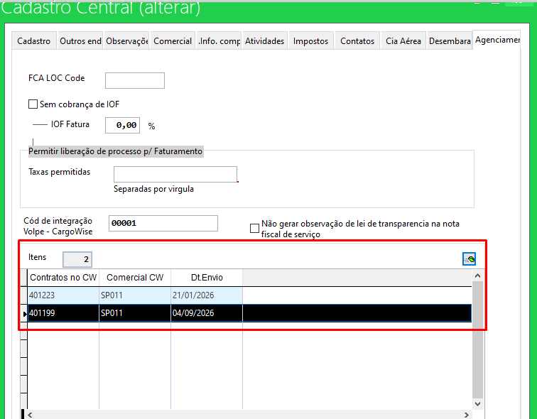

2. **Inscrição Estadual e Vendedor Associados em `TB_CADUNICO`:**
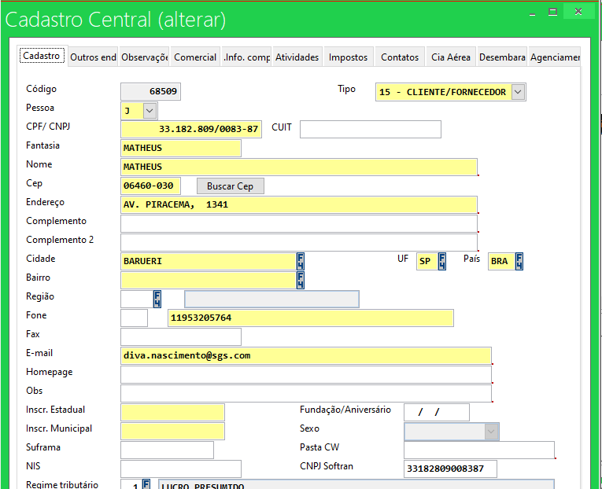

---

## 8. Módulo de Health Check e Versão — Version

<span class="badge badge-get">GET</span> `/v1/version`

Utilizado por sistemas de monitoramento contínuo, load balancers e testes de integridade para confirmar a disponibilidade da API:

* **Resposta HTTP 200:**


```json
{
  "status": 200,
  "version": "2.0.0",
  "service": "Ventana_node_ApiCargoWise2.0",
  "uptime": "14d 6h 32m",
  "database": "ONLINE",
  "timestamp": "2026-11-03T15:20:00Z"
}
```

---

## 9. Guia Rápido de Troubleshooting & Diagnóstico de Erros

| Erro Retornado | Módulo | Causa Provável | Ação Recomendada |
| :--- | :--- | :--- | :--- |
| `Token inválido` | Todos | Ausência ou valor errado no header `x-access-token`. | Configurar o token secreto Bearer correto na requisição. |
| `CNPJ is missed` | Account | Cadastro com `CountryCode = BRA` sem número de CNPJ. | Preencher o nó `BankFinancialInfo.CNPJ` com 14 dígitos. |
| `Charge code diferenciado com baixa automatica deve ser enviado sozinho.` | AP / AR | Envio de taxa de baixa automática junto com taxas comuns. | Desmembrar a fatura na CargoWise gerando uma fatura separada. |
| `Moeda estrangeira sem cotação` | AP | Moeda `USD` ou `EUR` enviada com `exchangeRate` zerado. | Preencher a taxa de câmbio oficial da data no CargoWise. |
| `ShipmentBranch inválido` | AR / AP | Filial operacional não cadastrada no ERP Volpe. | Verificar se a filial (`REC`, `BH`, etc.) está na `TB_EMPRESAS`. |
| `Bloco IBS_CBS deve estar zerado.` | AR | Itens sem retenção fiscal com valores no bloco de IBS/CBS. | Manter os campos de alíquota zerados para itens não tributados. |
| `Invoice já foi incluída` | AP / AR | Reenvio de fatura já processada anteriormente. | Comportamento normal de idempotência; nenhuma ação é necessária. |

---

## 10. Dicionário de Tabelas do Banco de Dados SQL Server

| Tabela SQL | Domínio | Descrição Funcional |
| :--- | :--- | :--- |
| `TB_CADUNICO` | Cadastral | Cadastro Único mestre de parceiros (clientes, fornecedores, agentes e transportadoras). |
| `AG_PROCESSO` | Operacional | Conhecimentos e processos operacionais de agenciamento de cargas (*Shipments*). |
| `AG_MASTER` | Operacional | Dados consolidados de conhecimentos Master (MAWB/MBL). |
| `AG_PROCESSOPLUS` | Operacional | Extensão dos processos com dados de agentes internacionais, controlling customer e referências. |
| `AG_PROCESSOTAXAS`| Operacional / Custo | Registro detalhado de cada taxa operacional de custo e despesa do processo. |
| `AG_FATURADO` | Comercial / Faturamento| Tabela mestre do faturamento de clientes (*AR*). |
| `FI_MOVFIN` | Financeiro | Títulos financeiros de Contas a Pagar (`TG_TIPO='P'`) e Contas a Receber (`TG_TIPO='R'`). |
| `FI_MOVRAT` | Financeiro / Contábil | Rateios de centro de custo e planos de contas contábeis vinculados a títulos. |
| `FI_MOVIMP` | Fiscal | Registro das retenções de impostos federais e municipais (ISS, PIS, COFINS, IRRF, CSLL). |
| `FI_BAIXAS` | Financeiro / Baixas | Histórico de liquidações, compensações e estornos financeiros. |
| `FT_NSERVICOS` | Fiscal / Emissão | Cabeçalho das Notas Fiscais de Serviço (NFS-e / RPS) geradas para a prefeitura. |
| `FT_NSITENS` | Fiscal / Emissão | Itens de serviços discriminados nas Notas Fiscais com alíquotas e deduções. |
| `CW_CONTRATO` | Comercial | Registro histórico dos números de contratos e vínculos com clientes. |
| `CW_JSON` | Auditoria / Log | Guarda cópia integral em Base64/Texto de todo payload JSON recebido pela API. |
| `TS_LOGS` | Auditoria / Log | Trilha de auditoria das transações com carimbo de usuário, data/hora e tipo de ação. |


