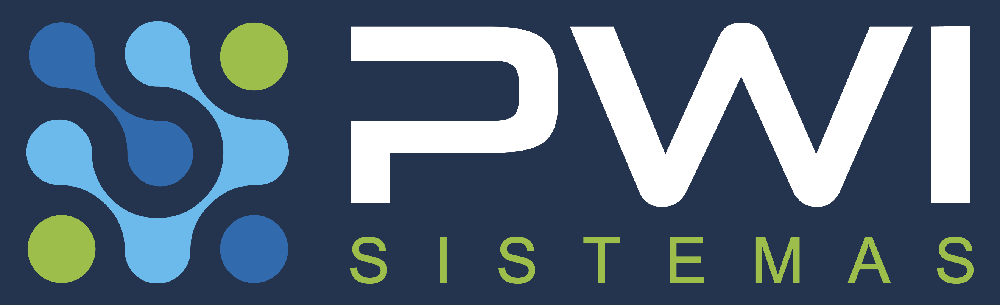
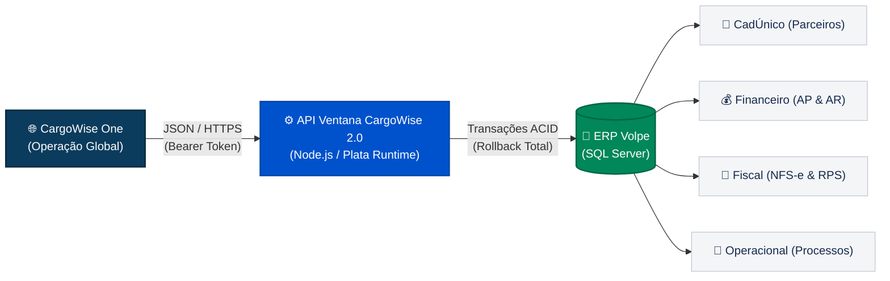
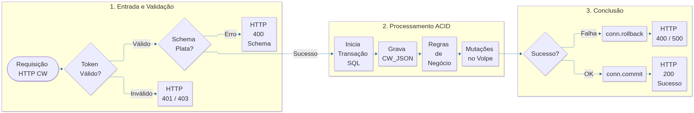
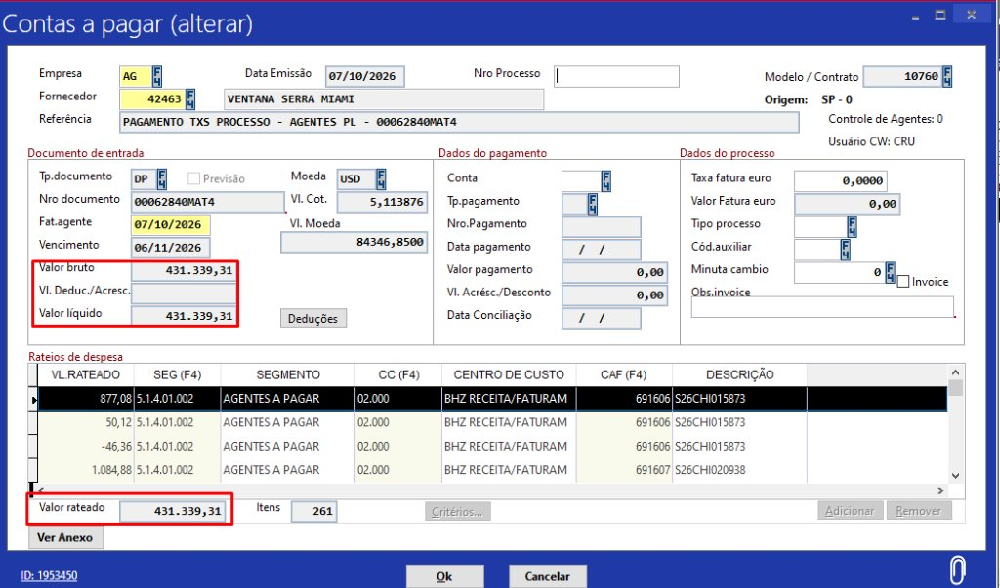
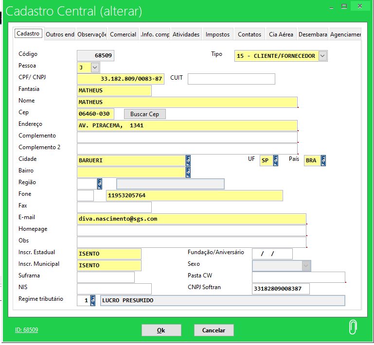

<div align="center">



# Solução de Integração CargoWise 2.0 &bull; ERP Volpe
### Plataforma de Automação Cadastral, Faturamento (AR), Contas a Pagar (AP), Emissão de NFS-e e Gestão Contratual

[](#status-da-homologação-no-erp-volpe)
[](#visão-geral-do-projeto)
[](#arquitetura-e-segurança)
[](#arquitetura-e-segurança)
[](#arquitetura-e-segurança)

<br />

### 📥 Central de Downloads Rápidos (Clique para Baixar)

[-dc2626?style=for-the-badge&logo=adobeacrobatreader&logoColor=white)](https://raw.githubusercontent.com/MatheusRafaelPWI/Ventana_node_ApiCargoWise2.0/main/Manual_de_Integracao_CargoWise.pdf)
&nbsp;
[-059669?style=for-the-badge&logo=json&logoColor=white)](https://raw.githubusercontent.com/MatheusRafaelPWI/Ventana_node_ApiCargoWise2.0/main/payloads_cargowise_json.zip)
&nbsp;
[-4f46e5?style=for-the-badge)](Apresentacao_Cliente_CargoWise.html)

<br />

**Portal Executivo de Documentação & Homologação para Clientes e Equipes Operacionais**

---

</div>

## 📌 Documentação Oficial & Downloads Individuais

Para download direto de qualquer arquivo de especificação ou exemplo prático de teste, utilize a tabela abaixo:

| Arquivo / Recurso | Tipo | Descrição | Tamanho | Ação de Download |
| :--- | :---: | :--- | :---: | :---: |
| 📕 **Manual de Integração CargoWise (PDF)** | `PDF` | Documento executivo oficial diagramado em alta resolução | ~1.3 MB | [](https://raw.githubusercontent.com/MatheusRafaelPWI/Ventana_node_ApiCargoWise2.0/main/Manual_de_Integracao_CargoWise.pdf) |
| 📦 **Pacote Completo de Payloads JSON (ZIP)** | `ZIP` | **Todos os 7 payloads de teste** empacotados em um único arquivo | ~21 KB | [](https://raw.githubusercontent.com/MatheusRafaelPWI/Ventana_node_ApiCargoWise2.0/main/payloads_cargowise_json.zip) |
| 📄 `01_account_parceiro_nacional_request.json` | `JSON` | Payload de cadastro/vínculo no CadÚnico (`POST /Account`) | 521 B | [](https://raw.githubusercontent.com/MatheusRafaelPWI/Ventana_node_ApiCargoWise2.0/main/json/01_account_parceiro_nacional_request.json) |
| 📄 `01_ap_fatura_padrao_request.json` | `JSON` | Payload fatura AP padrão com frete internacional (`POST /AP`) | 2.5 KB | [](https://raw.githubusercontent.com/MatheusRafaelPWI/Ventana_node_ApiCargoWise2.0/main/json/01_ap_fatura_padrao_request.json) |
| 📄 `02_ap_fatura_padrao_request.json` | `JSON` | Payload alternativo de AP com rateio contábil (`POST /AP`) | 2.5 KB | [](https://raw.githubusercontent.com/MatheusRafaelPWI/Ventana_node_ApiCargoWise2.0/main/json/02_ap_fatura_padrao_request.json) |
| 📄 `02_ar_faturamento_nfse_request.json` | `JSON` | Faturamento AR com NFS-e e retenções (`POST /AR`) | 4.9 KB | [](https://raw.githubusercontent.com/MatheusRafaelPWI/Ventana_node_ApiCargoWise2.0/main/json/02_ar_faturamento_nfse_request.json) |
| 📄 `03_ap_fatura_multiprocesso_real.json` | `JSON` | Caso real: 262 taxas em 58 processos (R$ 431k homologados) | 567 KB | [](https://raw.githubusercontent.com/MatheusRafaelPWI/Ventana_node_ApiCargoWise2.0/main/json/03_ap_fatura_multiprocesso_real.json) |
| 📄 `04_ar_faturamento_nfse_request.json` | `JSON` | Faturamento AR com Reforma Tributária IBS/CBS (`POST /AR`) | 4.9 KB | [](https://raw.githubusercontent.com/MatheusRafaelPWI/Ventana_node_ApiCargoWise2.0/main/json/04_ar_faturamento_nfse_request.json) |
| 📄 `05_contract_vinculo_request.json` | `JSON` | Vínculo de contrato comercial, IE e KAM (`POST /Contract`) | 224 B | [](https://raw.githubusercontent.com/MatheusRafaelPWI/Ventana_node_ApiCargoWise2.0/main/json/05_contract_vinculo_request.json) |
| 🌐 **Apresentação Executiva Standalone** | `HTML` | Visualização limpa em tela cheia para clientes sem GitHub | ~15 KB | [](Apresentacao_Cliente_CargoWise.html) |

> [!TIP]
> **Dica para o Cliente:** Clicando em qualquer botão de download acima, o arquivo é aberto ou baixado diretamente para a sua máquina.

---

## 🎯 Visão Geral do Projeto

A **API CargoWise 2.0** é o ecossistema de integração desenvolvido para conectar de forma bidirecional e automatizada a operação global de agenciamento de cargas no **CargoWise** ao ecossistema corporativo e fiscal do **ERP Volpe** da **Ventana Serra (Grupo Arcese)**.



### 💼 Benefícios e Ganhos de Negócio

* ⚡ **Eliminação Total de Digitação Manual:** Sincronização automática de parceiros, conhecimentos de frete, despesas operacionais e notas de débito.
* 🛡️ **Conformidade Fiscal e Reforma Tributária:** Mapeamento integral dos tributos retidos federais e municipais (ISS, PIS, COFINS, IRRF, CSLL) e suporte preparado para a transição do **IBS/CBS**.
* 🔒 **Segurança Transacional ACID:** Todas as operações que afetam múltiplos módulos realizam validação integral. Se qualquer validação fiscal falhar, 100% da transação sofre *rollback*, impedindo a geração de títulos órfãos ou notas fiscais desvinculadas.
* 💱 **Gestão Eficiente de Câmbio e Moedas Estrangeiras:** Conversão precisa de montantes em moedas como USD e EUR pela taxa oficial enviada, aplicando rateios corretos por centro de custo e processo operacional (*Shipment*).
* 🔄 **Ciclo Completo com Suporte a Estornos:** Tratamento nativo de cancelamentos e notas de crédito (`creditNote: true`), liquidando e estornando contas no ERP Volpe de forma espelhada ao CargoWise.

---

## 🏗️ Arquitetura e Segurança

A solução foi projetada sob padrões corporativos de alta resiliência e desempenho:

<div align="center" style="margin: 20px 0;">
  <a href="https://raw.githubusercontent.com/MatheusRafaelPWI/Ventana_node_ApiCargoWise2.0/main/media/diagram_mermaid_1.svg" target="_blank">
    
  </a>
  <p style="font-size: 0.85em; color: #57606a; margin-top: 6px;">
    <i>Figura 1: Arquitetura Técnica, Plata Runtime e Transacionalidade ACID no ERP Volpe</i>
  </p>
</div>

* **Engine:** Node.js com TypeScript sob o framework corporativo `pwi-plata-type`.
* **Banco de Dados:** Microsoft SQL Server com consultas parametrizadas (*Query Builder* imune a SQL Injection).
* **Autenticação:** Header HTTP `x-access-token` com token seguro Bearer individualizado por ambiente.
* **Fail-Fast & Validação Estrutural:** O payload é inspecionado contra tipagens rígidas antes da abertura de locks transacionais no banco de dados.

---

## 🚀 Módulos e Endpoints Disponíveis

A integração abrange todo o fluxo operacional, financeiro e comercial:

| Módulo | Endpoint | Método | Descrição Executiva | Tabelas Volpe Afetadas |
| :--- | :--- | :---: | :--- | :--- |
| **Parceiros** | `/v1/cargowise/Account` | `POST` | Cadastro unificado anti-duplicidade de clientes, fornecedores e agentes internacionais | `TB_CADUNICO`, `TB_CIDADES` |
| **Contas a Pagar** | `/v1/cargowise/AP` | `POST` | Inclusão de faturas de custos de armadores, agentes e prestadores com rateio contábil | `FI_MOVFIN`, `FI_MOVRAT`, `AG_PROCESSOTAXAS` |
| **Faturamento & NFS-e** | `/v1/cargowise/AR` | `POST` | Emissão de faturas a clientes, desdobramento de reembolsos e geração de NFS-e fiscal | `AG_FATURADO`, `FT_NSERVICOS`, `FT_NSITENS`, `FI_MOVFIN` |
| **Contratos** | `/v1/cargowise/Contract` | `POST` | Associação de número contratual, Inscrição Estadual e representante comercial (KAM) | `CW_CONTRATO`, `TB_CADUNICO` |
| **Monitoramento** | `/v1/version` | `GET` | Health Check em tempo real para monitorar status da API e conexão ao banco | Auditoria / Monitoramento |

---

## 📊 Status da Homologação no ERP Volpe

Todos os cenários operacionais foram homologados com dados reais e encontram-se certificados:

```
[✔] Cadastro de Parceiro Nacional com CNPJ e Regime Tributário      -> Validado (ID 36268)
[✔] Cadastro de Parceiro Internacional (NIF / Endereço Exterior)     -> Validado
[✔] Fatura AP Padrão com Rateio e Frete Internacional               -> Validado (ID 14008)
[✔] Fatura AP Multi-Processos (262 taxas, 58 processos, R$ 431k)    -> Validado (ID 1953450)
[✔] Estorno de Fatura AP com baixa e reversão financeira             -> Validado (FI_BAIXAS)
[✔] Faturamento AR com Emissão Automática de NFS-e / RPS             -> Validado (ID 80031)
[✔] Tratamento de Isenções e Reforma Tributária (IBS/CBS)           -> Validado
[✔] Vínculo Contratual Comercial com Representante KAM               -> Validado (ID 14022)
```

### 📸 Evidências Reais de Homologação

<div align="center" style="margin: 20px 0;">
  
  <p style="font-size: 0.85em; color: #57606a; margin-top: 6px;">
    <i>Figura 2: Homologação no ERP Volpe — Processamento de Fatura AP Complexa com 58 processos e 262 itens de taxa</i>
  </p>
</div>

<div align="center" style="margin: 20px 0;">
  
  <p style="font-size: 0.85em; color: #57606a; margin-top: 6px;">
    <i>Figura 3: Homologação no ERP Volpe — Mapeamento Automático do Parceiro na tabela mestre TB_CADUNICO</i>
  </p>
</div>

---

## 🧪 Como Realizar Testes e Homologações

Para enviar requisições de teste à API, baixe o pacote [`payloads_cargowise_json.zip`](https://raw.githubusercontent.com/MatheusRafaelPWI/Ventana_node_ApiCargoWise2.0/main/payloads_cargowise_json.zip) ou use os arquivos da pasta [`json/`](https://raw.githubusercontent.com/MatheusRafaelPWI/Ventana_node_ApiCargoWise2.0/main/json/):

### Cabeçalhos HTTP Obrigatórios
```http
POST /v1/cargowise/Account HTTP/1.1
Host: api.ventanaserrabrasil.com.br
Content-Type: application/json
x-access-token: Bearer SEU_TOKEN_AUTORIZADO
```

### Exemplo Rápido: Verificação de Disponibilidade
```bash
curl -X GET "https://api.ventanaserrabrasil.com.br/v1/version"
```

**Resposta:**
```json
{
  "status": 200,
  "version": "2.0.0",
  "service": "Ventana_node_ApiCargoWise2.0",
  "database": "ONLINE"
}
```

---

## 💼 Informações Corporativas & Suporte

* **Cliente:** Ventana Serra do Brasil / Grupo Arcese
* **Desenvolvimento & Integração:** PWI Tecnologia
* **Ambiente Atual:** Homologação / Produção
* **Repositório:** `Ventana_node_ApiCargoWise2.0`

> Para dúvidas técnicas, credenciais de homologação ou solicitações de customização, contate a equipe técnica responsável.

---

<div align="center">
  <sub>Ventana Serra &bull; Grupo Arcese &bull; PWI Tecnologia &copy; 2026 Todos os direitos reservados.</sub>
</div>
